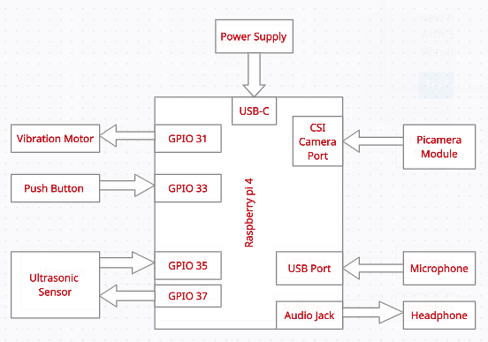
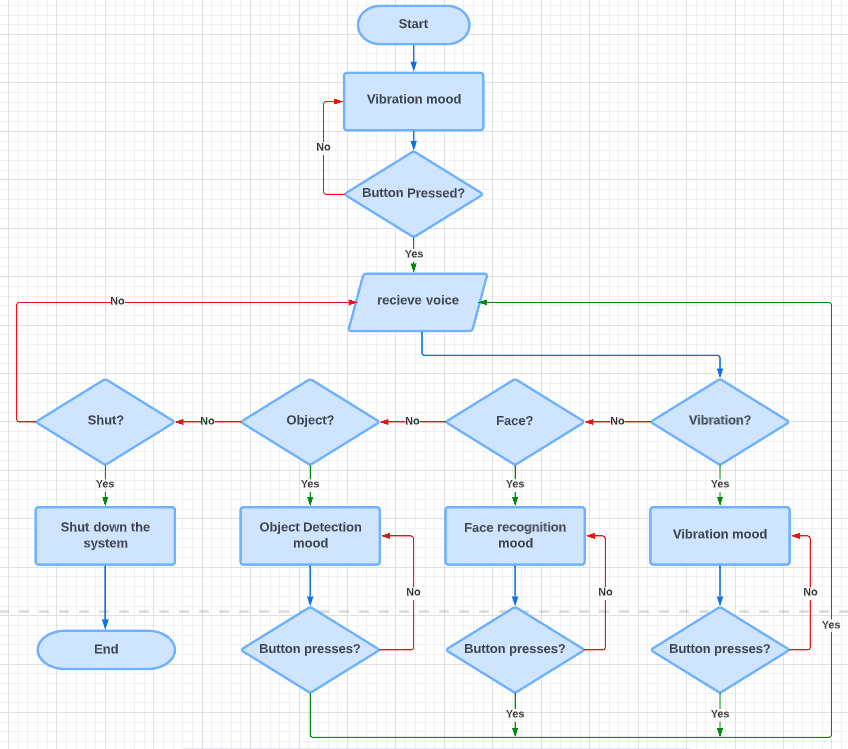
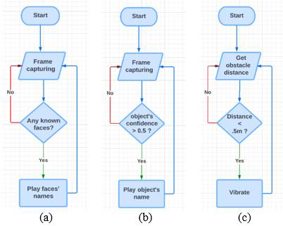
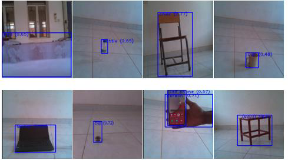
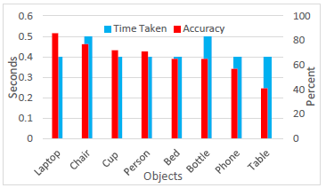
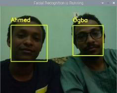

<div align="center">

# 👓 IGforVIP — Intelligent Glasses for Visually Impaired People

**A low-cost wearable assistant built on a Raspberry Pi 4 that recognizes faces, detects objects, and warns about obstacles, controlled entirely by voice.**

[](paper/Intelligent_Glasses_for_Visually_Impaired_People.pdf)
[](docs/BSc_Thesis_IGforVIP.pdf)
[](docs/Paper_Presentation.pdf)


*Prototype: 1) push button 2) glasses 3) ultrasonic sensor 4) camera 5) vibration motor 6) USB mic 7) Raspberry Pi 4 8) power socket 9) headphone jack*

</div>

---

## 📖 Overview

More than 2 billion people worldwide live with some form of vision impairment (WHO, 2019). Commercial assistive glasses such as OrCam MyEye cost thousands of dollars. **IGforVIP** is our B.Sc. graduation project at **Sudan University of Science and Technology** (Electrical Engineering). It combines the core features of those devices in a **~$170, 320 g** prototype that runs fully on a Raspberry Pi 4.

The user picks a mode by voice, and the glasses respond with **audio** (names of people and objects) or **haptic** feedback (vibration when an obstacle is close).

| Mode | What it does | How |
|---|---|---|
| 🧭 **Navigation** *(default)* | Vibrates when an obstacle is within **50 cm**. Pulses get faster as it gets closer | HC-SR04 ultrasonic sensor + vibration motor |
| 🙂 **Face Recognition** | Speaks the name of known people in front of the user | [`face_recognition`](https://github.com/ageitgey/face_recognition) (dlib, 99.38% on LFW) |
| 📦 **Object Detection** | Speaks the names of everyday objects (cup, chair, laptop, …) | TensorFlow Lite **EfficientDet-Lite0** (80 COCO classes) |

Navigation is the default because it uses little compute and also works in the dark.

## ⚙️ How it works

<p align="center">
  
  
</p>

1. On power-up the glasses start in **Navigation** mode.
2. The user presses the **push button**. A voice asks *"Hi user, what mode do you want?"*
3. The user says a keyword such as **"face"** / **"recognition"**, **"object"** / **"detection"**, or **"vibration"**. Speech is converted to text with the Google Speech Recognition API.
4. The selected mode runs in a loop until the button is pressed again.
5. To avoid repeating itself, the system remembers the most recent detections and only announces a name when it is new.

<p align="center">
  
  <br><em>Flowcharts: (a) face recognition (b) object detection (c) navigation</em>
</p>

## 📊 Results

<p align="center">
  
  
</p>

- **Speed:** each object detection takes **under ~0.5 s** on the Raspberry Pi 4, which is fast enough for real-time use.
- **Accuracy:** good on most objects. Small tables are sometimes confused with chairs because both have four legs close together.
- **Face recognition:** highly accurate, but speed depends on lighting and image clarity.
- **Battery:** ~12 h on a 10,000 mAh power bank.

<p align="center"></p>

### Comparison with commercial products

| | **IGforVIP** | Envision Glasses | OrCam MyEye 2 |
|---|---|---|---|
| Face recognition | ✅ | ✅ | ✅ |
| Object detection | ✅ | ✅ | ✅ |
| Obstacle detection | ✅ Ultrasonic | GPS navigation | ❌ |
| Control | Voice + button | Voice / touchpad | Voice / gesture |
| Price | **~$170** | $1,796 | $3,699 |

*Full comparison in Table 1 of the [paper](paper/Intelligent_Glasses_for_Visually_Impaired_People.pdf).*

## 🔧 Hardware

| Component | Purpose |
|---|---|
| Raspberry Pi 4 Model B (8 GB RAM, 32 GB SD) | Main processor |
| Raspberry Pi Camera v1.3 (5 MP) | Image input (mounted on the left lens) |
| HC-SR04 ultrasonic sensor | Distance measurement (between the lenses) |
| 10 mm coin vibration motor | Haptic obstacle alert |
| Push button | Mode switching |
| Mini USB microphone | Voice commands |
| Wired headphones (3.5 mm) | Audio feedback |
| 10,000 mAh power bank | Power (carried in an arm bag with the Pi) |

**Wiring** (physical `BOARD` pin numbers, as set in the code):

| Pin | Connected to |
|---|---|
| 31 | Push button (input, pull-down) |
| 33 | Vibration motor |
| 35 | HC-SR04 `ECHO` |
| 37 | HC-SR04 `TRIG` |

> ⚠️ The HC-SR04 `ECHO` pin outputs 5 V. Use a voltage divider (e.g. 1 kΩ / 2 kΩ) before connecting it to the Pi's 3.3 V GPIO.

## 🚀 Getting started

### 1. Requirements
- Raspberry Pi 4 running **Raspberry Pi OS (Legacy)** with the legacy camera stack enabled. The code uses the original `picamera` library.
- Python 3
- An internet connection, used for voice commands via Google Speech Recognition

### 2. Install
```bash
git clone https://github.com/Ali-M-Mustafa/smart-glasses-for-visually-impaired.git
cd smart-glasses-for-visually-impaired

sudo apt install -y portaudio19-dev cmake libatlas-base-dev   # needed by PyAudio and dlib
pip3 install -r requirements.txt
```
> Building `dlib` (needed by `face_recognition`) on a Raspberry Pi can take a long time. Increasing swap space helps.

### 3. Add known faces
Create a `src/people/` folder and add **one photo per person**. Name each file after the person **without an extension**, e.g. `src/people/ali`. Each name needs a matching audio file in `src/voices/` (e.g. `src/voices/ali`), which is played when that person is recognized.

### 4. Run
```bash
cd src
python3 IGforVIP.py
```
Run from inside `src/` because the code loads `voices/`, `people/`, and the model using relative paths.

## 📁 Repository structure

```
IGforVIP/
├── src/
│   ├── IGforVIP.py              # Main program: GPIO, camera, mode switching loop
│   ├── Face.py                  # Face recognition mode
│   ├── detect.py                # Object detection mode
│   ├── Vibration.py             # Ultrasonic distance + vibration (navigation mode)
│   ├── speech.py                # Voice command recognition
│   ├── play.py                  # Audio playback helper
│   ├── object_detector.py       # TFLite detector wrapper (TensorFlow examples, Apache 2.0)
│   ├── utils.py                 # Bounding-box drawing (TensorFlow examples, Apache 2.0)
│   ├── efficientdet_lite0.tflite# Pre-trained object detection model
│   └── voices/                  # Pre-recorded audio for object names, names and prompts
├── paper/                       # Published paper (PDF)
├── docs/                        # B.Sc. thesis, presentation slides, project proposal
├── images/                      # Figures used in this README
├── requirements.txt
└── LICENSE
```

## 🚧 Limitations & future work

- Face recognition needs good lighting and does not work well in the dark.
- Voice commands need an internet connection (Google Speech API).
- The *shutdown* voice command described in the paper is not in this version of `speech.py`.
- **Future work:** text recognition (OCR), scene description, and offloading computation to the cloud (e.g. Azure) for a lighter, faster device.

## 📄 Publication

> A. Mustafa, A. Omer, and O. Mohammed, "Intelligent Glasses for Visually Impaired People," *<Conference / Journal name>*, 2022. [[PDF]](paper/Intelligent_Glasses_for_Visually_Impaired_People.pdf)

```bibtex
@inproceedings{mustafa2022igforvip,
  title     = {Intelligent Glasses for Visually Impaired People},
  author    = {Mustafa, Ali and Omer, Ahmed and Mohammed, Ogba},
  booktitle = {<Conference / Journal name>},
  year      = {2022},
  doi       = {<DOI>}
}
```

## 👥 Team

Sudan University of Science and Technology, School of Electrical and Nuclear Engineering, 2022

- **Ali Motasim Aalim Mustafa**
- **Ahmed Abdullatif Mohammed Omer**
- **Mohammed Abdelazeem Aljack Maryoud**
- **Ogba Majdy Ahmed Mohammed Ali**

**Supervisor:** Ust. Galal Abdalrahman Mohammed Hammad

### Acknowledgments
We thank Eng. Aalim Mustafa for his guidance and support, and Dr. Ayman Tawfiq and Eng. Mohammed Noman (Ajman University) for their help with the paper.

## 📜 License

The project code is released under the [MIT License](LICENSE). `object_detector.py` and `utils.py` are adapted from the TensorFlow Lite examples and remain under the Apache 2.0 License, as noted in their file headers.
