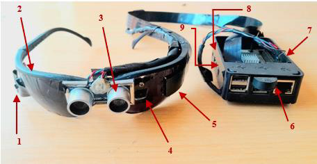

# IGforVIP — Intelligent Glasses for Visually Impaired People
### A low-cost wearable assistant built on a Raspberry Pi 4 that recognizes faces, detects objects, and warns about obstacles, controlled entirely by voice.

[](https://ieeexplore.ieee.org/abstract/document/10008291)




*Prototype: 1) push button 2) glasses 3) ultrasonic sensor 4) camera 5) vibration motor 6) USB mic 7) Raspberry Pi 4 8) power socket 9) headphone jack*

</div>

---

## Overview

More than 2 billion people worldwide live with some form of vision impairment (WHO, 2019). Commercial assistive glasses such as OrCam MyEye cost thousands of dollars. **IGforVIP** is our B.Sc. graduation project at **Sudan University of Science and Technology** (Electrical Engineering). It combines the core features of those devices in a **~$170, 320 g** prototype that runs fully on a Raspberry Pi 4.

The user picks a mode by voice, and the glasses respond with **audio** (names of people and objects) or **haptic** feedback (vibration when an obstacle is close).

| Mode | What it does | How |
|---|---|---|
| **Navigation** *(default)* | Vibrates when an obstacle is within **50 cm**. Pulses get faster as it gets closer | HC-SR04 ultrasonic sensor + vibration motor |
| **Face Recognition** | Speaks the name of known people in front of the user | [`face_recognition`](https://github.com/ageitgey/face_recognition) (dlib, 99.38% on LFW) |
| **Object Detection** | Speaks the names of everyday objects (cup, chair, laptop, …) | TensorFlow Lite **EfficientDet-Lite0** (80 COCO classes) |

Navigation is the default because it uses little compute and also works in the dark.

## How it works

1. On power-up the glasses start in **Navigation** mode.
2. The user presses the **push button**. A voice asks *"Hi user, what mode do you want?"*
3. The user says a keyword such as **"face"** / **"recognition"**, **"object"** / **"detection"**, or **"vibration"**. Speech is converted to text with the Google Speech Recognition API.
4. The selected mode runs in a loop until the button is pressed again.
5. To avoid repeating itself, the system remembers the most recent detections and only announces a name when it is new.


## Results

- **Speed:** each object detection takes **under ~0.5 s** on the Raspberry Pi 4, which is fast enough for real-time use.
- **Accuracy:** good on most objects. Small tables are sometimes confused with chairs because both have four legs close together.
- **Face recognition:** highly accurate, but speed depends on lighting and image clarity.
- **Battery:** ~12 h on a 10,000 mAh power bank.


## Hardware

| Component | Purpose |
|---|---|
| Raspberry Pi 4 Model B (8 GB RAM, 32 GB SD) | Main processor |
| Raspberry Pi Camera v1.3 (5 MP) | Image input (mounted on the left lens) |
| HC-SR04 ultrasonic sensor | Distance measurement (between the lenses) |
| 10 mm coin vibration motor | Haptic obstacle alert |
| Push button | Mode switching |
| Mini USB microphone | Voice commands |
| Wired headphones (3.5 mm) | Audio feedback |
| 10,000 mAh power bank | Power (carried in an arm bag with the Pi) |


## Getting started

### 1. Requirements
- Raspberry Pi 4 running **Raspberry Pi OS (Legacy)** with the legacy camera stack enabled. The code uses the original `picamera` library.
- Python 3
- An internet connection, used for voice commands via Google Speech Recognition

### 2. Install
```bash
git clone https://github.com/Ali-M-Mustafa/IGforVIP.git
cd IGforVIP

sudo apt install -y portaudio19-dev cmake libatlas-base-dev   # needed by PyAudio and dlib
pip3 install -r requirements.txt
```
> Building `dlib` (needed by `face_recognition`) on a Raspberry Pi can take a long time. Increasing swap space helps.

### 3. Add known faces
Create a `src/people/` folder and add **one photo per person**. Name each file after the person **without an extension**, e.g. `src/people/ali`. Each name needs a matching audio file in `src/voices/` (e.g. `src/voices/ali`), which is played when that person is recognized.

### 4. Run
```bash
cd src
python3 IGforVIP.py
```
Run from inside `src/` because the code loads `voices/`, `people/`, and the model using relative paths.

## Repository structure

```
IGforVIP/
├── src/
│   ├── IGforVIP.py              # Main program: GPIO, camera, mode switching loop
│   ├── Face.py                  # Face recognition mode
│   ├── detect.py                # Object detection mode
│   ├── Vibration.py             # Ultrasonic distance + vibration (navigation mode)
│   ├── speech.py                # Voice command recognition
│   ├── play.py                  # Audio playback helper
│   ├── object_detector.py       # TFLite detector wrapper (TensorFlow examples, Apache 2.0)
│   ├── utils.py                 # Bounding-box drawing (TensorFlow examples, Apache 2.0)
│   ├── efficientdet_lite0.tflite# Pre-trained object detection model
│   └── voices/                  # Pre-recorded audio for object names, names and prompts
├── hardware.png
├── requirements.txt
└── LICENSE
```


## Publication

> A. Mustafa, A. Omer, and O. Mohammed, "Intelligent Glasses for Visually Impaired People," *2022 14th International Conference on Computational Intelligence and Communication Networks (CICN)*, 2022. [[PDF]](https://ieeexplore.ieee.org/abstract/document/10008291)

```bibtex
@inproceedings{mustafa2022igforvip,
  title     = {Intelligent Glasses for Visually Impaired People},
  author    = {Mustafa, Ali and Omer, Ahmed and Mohammed, Ogba},
  booktitle = {2022 14th International Conference on Computational Intelligence and Communication Networks (CICN)},
  year      = {2022},
  doi       = {10.1109/CICN56167.2022.10008291}
}
```


## License

The project code is released under the [MIT License](LICENSE). `object_detector.py` and `utils.py` are adapted from the TensorFlow Lite examples and remain under the Apache 2.0 License, as noted in their file headers.
